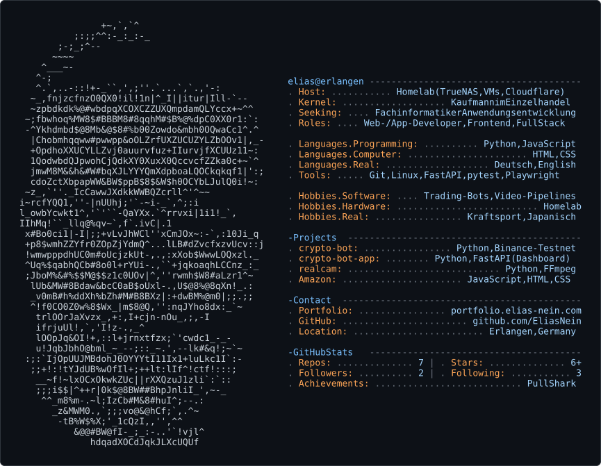

   <picture>
     <source media="(prefers-color-scheme: dark)" srcset="profile-card-dark.svg">
     <source media="(prefers-color-scheme: light)" srcset="profile-card-light.svg">
     
   </picture>

# Hi, ich bin Elias

Ich komme aus Erlangen, habe Kaufmann im Einzelhandel gelernt und steige jetzt in die Softwareentwicklung ein. Ich bringe mir Programmieren selbst bei und setze es in eigenen Projekten um.

## Wonach ich suche

- Ausbildung zum **Fachinformatiker für Anwendungsentwicklung**
- Einstieg als **App || Web-Developer**, **Frontend** || **Full Stack**

## Projekte

### [crypto-bot](https://github.com/EliasNein/crypto-bot)
Vier eigenständige Python-Bots (DCA, Grid, Trend-Following und ein Kapital-Allocator) gegen die Binance-Spot-**Testnet**-API, es wird kein echtes Geld bewegt. Dazu eine eigene Dashboard-App (FastAPI, nur lesend).
- Sicherheit zuerst: Dry-Run als Standard, Notaus auf mehreren Wegen, atomar geschriebene Ledger, Abgleich mit der Börse nach Verbindungsfehlern
- Mehrere Review-Runden, jeder Fund mit Test; neue Prüfungen habe ich per Mutationstest abgesichert (den Fehler wieder einbauen, der Test muss rot werden)
- Backtests über historische Marktphasen, Betrieb als systemd-Dienste auf meinem Homeserver
- Doku auf Deutsch und Englisch
- Technik: Python, FastAPI, JavaScript, pytest/unittest, Playwright, Linux

### [Reparatur-Kompass](https://github.com/EliasNein/reperatur-kompass-public)
Local-first App für Android und iOS, die Kassenbons verwaltet und zeigt, welche Ansprüche bei einem Produkt voraussichtlich noch bestehen: Gewährleistung, Herstellergarantie und das neue Recht auf Reparatur. Kein Konto, kein Server, alle Daten bleiben auf dem Gerät. Das MVP ist fertig und in der Testphase, der Quellcode ist derzeit nicht öffentlich.
- Regel-Engine für Fristen nach deutschem Recht (BGB), die Regeln liegen als versionierte JSON-Daten mit Quellen und Prüfstand vor
- Belege per Kamera, Galerie oder PDF erfassen, Texterkennung direkt auf dem Gerät
- Defektfall-Assistent mit Musterbrief als PDF und einer Fall-Akte mit Zeitleiste
- Über 1.000 automatisierte Tests, dazu Property-based Tests, Mutationstests (Stryker) und End-to-End-Flows (Maestro)
- Technik: TypeScript, React Native, Expo, SQLite, Jest

### [realcam](https://github.com/EliasNein/realcam)
Lokale Video-Pipeline, die Gameplay-Aufnahmen den Look einer echten Kamera gibt: Bewegungsunschärfe, Restaurierung, Filmkorn und Color Grading. Läuft komplett auf dem eigenen Rechner, konfigurierbar über Presets.
- Technik: Python, FFmpeg

### [Amazon](https://github.com/EliasNein/Amazon)
Online-Shop im Stil von Amazon. Seiten für Produkte, Checkout, Bestellungen und Sendungsverfolgung, dazu ein Backend-Teil und Tests. Nicht mit Amazon verbunden.
- Technik: JavaScript, HTML, CSS

## Technik

**Sprachen:** Python, JavaScript, TypeScript, HTML, CSS
**Werkzeuge:** Git, GitHub, Linux, systemd, FastAPI, React Native, Expo, SQLite, pytest, Jest, Playwright, Maestro, Stryker
**Homelab:** TrueNAS, virtuelle Maschinen, Cloudflare Tunnel

## Hintergrund

Ausbildung zum Kaufmann im Einzelhandel bei Aldi Süd (2021 bis 2024), danach als Führungskraft übernommen, mit zeitweiser Vertretung der Filialleitung. Von dort nehme ich Verlässlichkeit und den Blick für Abläufe mit.

Ich arbeite mit KI-Werkzeugen wie Claude Code. Aufbau, Entscheidungen, Prüfung und Betrieb meiner Projekte liegen bei mir.

## Neben dem Code

Homelab, Kraftsport, Japanisch. Sprachen: Deutsch (Muttersprache), Englisch

## Kontakt

Portfolio: [portfolio.elias-nein.com](https://portfolio.elias-nein.com)

Email: eliasit.business@gmail.com
